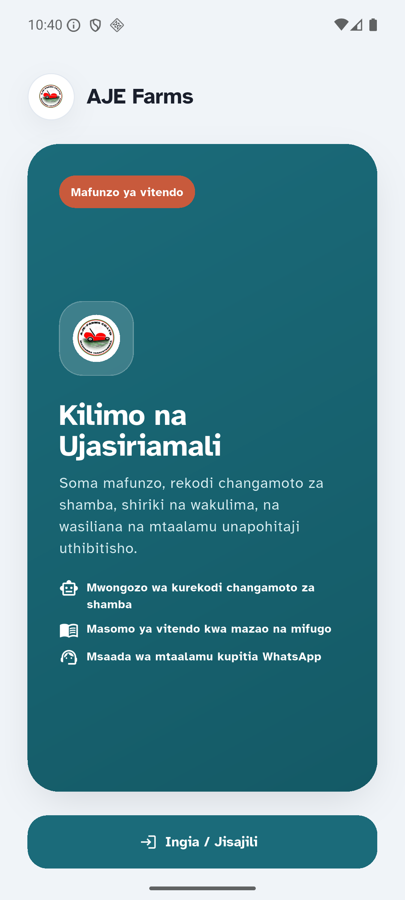
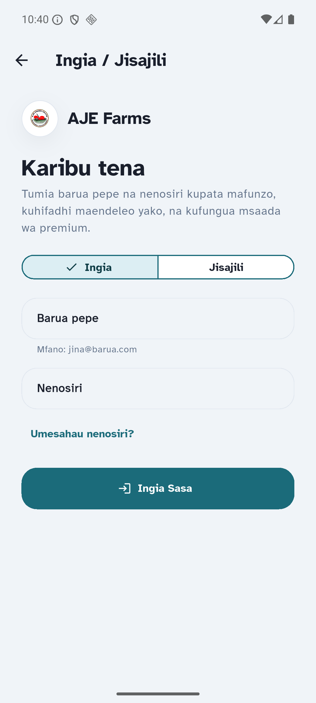

# QA Report: AJE Farms Android release

| Field | Value |
|-------|-------|
| **Date** | 2026-07-31 |
| **Target** | Android release APK and AAB |
| **Commit** | `29b42b6` (`fix: secure learner access and release UX`) |
| **Tier** | Standard release QA |
| **Scope** | First-launch authentication gate, release artifact, automated regressions |
| **Screenshots** | 5 |
| **Framework** | Flutter |

## Health Score: 98/100

| Category | Score |
|----------|-------|
| Functional | 95 |
| Visual | 94 |
| UX | 98 |
| Release artifact | 100 |
| Automated regression | 100 |

## Results

| Check | Result | Evidence |
|-------|--------|----------|
| Server regression suite | PASS | 112 passed; 7 database tests skipped because no local `DATABASE_URL` was supplied |
| Flutter regression suite | PASS | 121 passed |
| Static analysis | PASS | `flutter analyze` reported no issues |
| Production-configured APK build | PASS | Signed APK built (59.0 MB) and native package validation passed for `com.ajefarms.mobile` |
| Production-configured AAB build | PASS | AAB built (57.6 MB) |
| First launch | PASS | Registration/sign-in CTA is the sole primary action |
| Auth navigation | PASS | CTA opens the sign-in/registration form |
| Guest course access | PASS | Selecting the course area redirects a guest to authentication |

## Issues

### ISSUE-001: Guest return state showed a misleading content-sync failure

| Field | Value |
|-------|-------|
| **Severity** | fixed |
| **Category** | UX / functional |
| **State** | An unauthenticated user leaves authentication and returns to the home/account areas |

**Root cause:** Production dependencies refreshed the protected catalog before authentication. The API correctly rejected that request, but the cache marked it as a sync failure and `MainShell` surfaced a false offline-style banner.

**Fix:** The initial production catalog refresh is deferred until a real session exists. The stale-catalog banner is now additionally limited to signed-in users. A widget regression test forces a failed catalog refresh in guest state and verifies the registration CTA appears without the banner.

**Verified:** 122 Flutter tests passed, static analysis is clean, and a rebuilt production-configured APK was installed on a reset emulator. The first-launch screen has no false refresh banner.

## Release proof

First launch shows a dedicated onboarding screen with only **Ingia / Jisajili**:

Selecting that CTA opens the sign-in/registration screen:

Selecting the course area while still unauthenticated also returns the user to the authentication form, confirming that courses are gated:

## Ship Readiness

**Verdict: READY FOR ANDROID PUBLISHING.** The authentication gate and course protection work, and ISSUE-001 is fixed and verified. Push notification configuration remains intentionally deferred (`AJE_PUSH_PROVIDER=development`); keep public push features disabled until Firebase is configured.
