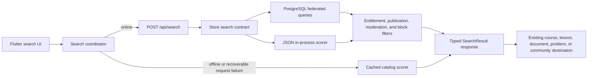

# Design: Unified Learner Search

Generated by /office-hours on 2026-08-15
Branch: `codex/native-android-release`
Repo: `nurulabsai/aje-farms`
Status: APPROVED
Mode: Startup
Supersedes: `frankmchaina-codex-native-android-release-design-audit-20260726.md`

## Problem Statement

AJE Farms learners cannot search across the app. They must browse separate tabs, course cards, lesson lists, saved documents, configured topic filters, and the community feed while already knowing where relevant information is likely to live. The requested capability is one Swahili-first search experience for topics and other learner-visible material, reachable throughout the main app and reinforced with contextual search controls on content-heavy screens.

## Demand Evidence

No direct observation, support transcript, or search-query evidence is available yet. This design is therefore a product judgment grounded in the current content model rather than verified user behavior. The first validation task is to observe farmers trying to find real content and capture the exact words they use.

## Status Quo

- Courses are browsed as an unfiltered catalog in `CoursesScreen`.
- Community posts can be narrowed only by configured topic chips.
- Saved documents are split into saved and all-document lists without text search.
- Home topics navigate learners toward broad areas, but do not resolve a specific query.
- Mwalimu AI answers questions, but it is not a deterministic content finder and must remain a separate interaction.

## Target User & Narrowest Wedge

The target user is a Tanzanian smallholder farmer using the native Android learner app in Swahili, potentially with intermittent connectivity. The narrowest useful release is a unified query that finds courses, individual lessons, documents, agricultural problem categories, and community posts, opens the existing destination, respects account access, and falls back to cached content offline.

## Constraints

- Flutter Material 3 client with five persistent learner tabs.
- Express API with interchangeable PostgreSQL/Supabase and JSON stores.
- The authenticated `/api/catalog` response already redacts protected lesson and document fields for accounts without learning access.
- `CachedAppRepository.clearProtectedContent()` prevents protected catalog data crossing account boundaries; any local search index must obey the same lifecycle.
- Community results must continue to honor moderation and viewer-specific author blocking.
- Search is Swahili-first. English stemming must not be used as the default language strategy.
- Touch targets must remain at least 48dp, body text at least 16sp effective, and controls must retain screen-reader labels and large-text behavior.
- Search must not require a new third-party search service.

## Premises

1. Search returns only learner-visible content the current account may discover. Locked premium results may appear with a lock label, but selecting one follows the existing access gate.
2. Search covers course titles and descriptions, lesson titles and permitted descriptions, documents, problem categories, community post bodies, related topics, and tags.
3. A global search icon appears on all five main learner tabs. Courses, Community, and Saved Documents also show contextual search controls. Auth, onboarding, payment, form, detail, and admin screens do not receive redundant search fields.
4. Online search uses backend relevance and typo tolerance. Offline search uses the current account's cached catalog and states that its results may be incomplete.
5. Results open existing destinations. Search does not generate AI answers.

## Landscape Findings

- Flutter's Material `SearchAnchor` supports a full-screen mobile search route, asynchronous suggestions, and debounced remote requests.
- PostgreSQL full-text search provides weighted document vectors and relevance ranking; GIN is its preferred text-search index type.
- PostgreSQL `pg_trgm` provides indexed similarity matching suitable for misspellings and partial words across many natural languages.
- AJE Farms should use the `simple` text-search configuration, Unicode-aware normalization, trigram similarity, and curated agricultural synonyms. Applying English stemming to Swahili content would distort relevance.

## Approaches Considered

### Approach A: Local Catalog Index

Flatten `CatalogSnapshot` into typed Dart search records and rank entirely on the device. This is the smallest implementation and naturally supports offline use, but it cannot centrally improve ranking and cannot search protected text omitted from the viewer's catalog response.

Effort: small, approximately 3–4 human days or 2–3 AI-assisted hours.
Completeness: 7/10.

### Approach B: Federated Hybrid

Add an authenticated search endpoint and store-level search contract. PostgreSQL queries authoritative published content and community tables directly using weighted language-neutral vectors and trigram similarity; the JSON store uses the same public contract with an in-process scorer. Flutter calls the endpoint online and uses a simplified compatible scorer over the current cached catalog offline.

Effort: medium-to-large, approximately 3–5 human weeks or 35–51 AI-assisted engineering hours, plus field-study scheduling.
Completeness: 10/10.

### Approach C: Dedicated Search Projection

Create and synchronize a `search_documents` projection containing every searchable content type and its weighted search representation. This gives one clean query surface and scales well, but it duplicates source data and introduces backfill and synchronization failure modes that the current catalog size does not justify.

Effort: large, approximately 4–6 human weeks or 50–75 AI-assisted engineering hours, followed by ongoing synchronization and backfill operations.
Completeness: 10/10.

## Recommended Approach

Use **Approach B: Federated Hybrid**. It keeps existing content tables authoritative, supports viewer-aware community and entitlement filtering, provides centrally tunable online relevance, and still works offline without introducing a second content system that can drift.

### Architecture



### Shared result model

Add a typed search result shared concept in the API response and Flutter model:

```text
SearchResult
  kind: course | lesson | document | problem | community
  id: destination entity ID
  parentId: course ID for lessons/documents, otherwise null
  title: safe display title
  snippet: viewer-safe plain-text context, nullable
  metadata: short localized context such as course name or reply count
  isPremium: whether selection follows the existing access gate
  score: server-only diagnostic ranking value; omit from production JSON
```

Result identity is `(kind, id)`. The API must never return storage paths, private document URLs, author phone numbers, internal moderation fields, or hidden lesson descriptions.

### API contract

Add an authenticated endpoint:

```http
POST /api/search
Authorization: Bearer <session>
Content-Type: application/json

{
  "query": "nyanya ugonjwa",
  "scope": "all",
  "limit": 20
}
```

Response:

```json
{
  "query": "nyanya ugonjwa",
  "scope": "all",
  "results": [
    {
      "kind": "course",
      "id": "course-id",
      "parentId": null,
      "title": "Magonjwa ya nyanya",
      "snippet": "Dalili, kinga na tiba salama",
      "metadata": "Kozi",
      "isPremium": false
    }
  ],
  "truncated": false
}
```

Contract rules:

- Normalize and trim the query server-side; reject unknown or malformed body fields.
- Empty or one-character queries return suggestions locally and do not call the API.
- Accept 2–120 Unicode characters after trimming.
- `limit` defaults to 20 and is capped at 50.
- `savedDocumentIds` is accepted only for `documents` scope, is deduplicated, requires non-empty string IDs of at most 200 characters, and remains bounded by the API's 64 KB JSON-body limit. It is never trusted for eligibility: only IDs that also appear in the authenticated, viewer-visible catalog can receive the saved boost.
- Unknown scopes return HTTP 400. Missing/invalid sessions retain existing authentication behavior.
- Apply the existing API request throttling pattern, with a search-specific ceiling that permits normal debounced typing but limits scraping.
- A recoverable timeout or 5xx response may fall back to cached results. Authentication and authorization errors must not silently fall back to potentially stale protected data.
- Version 1 returns a single relevance-ranked response capped at 50 results. It deliberately has no pagination: the launch catalog is small, and federated keyset pagination would add unstable cross-source score and cursor semantics. Set `truncated: true` when more eligible matches exist.

Scope semantics are fixed:

| Scope | Included kinds | Contextual behavior |
|---|---|---|
| `all` | course, lesson, problem, document, community | Global search default |
| `learning` | course, lesson, problem, document | Courses default; documents remain discoverable because they belong to courses |
| `community` | community | Community default; configured topic chips remain available |
| `documents` | document | Saved Documents default; the authenticated endpoint intersects submitted saved IDs with current eligibility and applies the documents-scope saved boost before truncation |

Saved Documents search is not saved-only. The existing screen already contains both saved and all-document sections. For online `documents` scope, Flutter sends the current account's `savedDocumentIds` within the API body limit; the server intersects them with eligible document rows, applies a +2000 saved-status boost, ranks, deduplicates, and then truncates the final response to 50. `truncated` describes that final ordered set. No cached record is merged into a successful online response. For offline `documents` scope, the current-account scorer applies the same +2000 partition locally. Global and `learning` scopes do not apply this boost.

### Store contract

Add `searchCatalog({ viewerUserId, query, scope, limit })` to both store implementations. Return already-authorized result projections rather than raw rows.

The PostgreSQL implementation searches:

- Published courses and their public title/description fields.
- Learner-visible lessons belonging to published courses.
- Published content documents.
- Static/configured problem categories merged by the store layer.
- Community posts with exactly `moderation_status='visible'` after viewer-specific block filtering; `hidden` and unknown future statuses are excluded.

The JSON implementation searches its catalog and community state with the same eligibility, result shape, stable tie-breakers, and broad weighting rules. Tests must run the same golden query cases against both stores.

### PostgreSQL indexing

Add a migration that enables `pg_trgm` if needed and creates targeted expression indexes on normalized searchable columns. Use `to_tsvector('simple', ...)` for language-neutral token search and trigram indexes for title, tag, and short-query similarity. Prefer partial indexes limited to published or learner-visible rows where the schema permits it.

Production index rollout is an operational step, not merely an additive migration:

1. Preflight that the deployment role may enable `pg_trgm`; otherwise enable it through the managed Supabase administrator before release.
2. Record table sizes and require at least twice the estimated index size as free disk headroom.
3. Build production indexes with `CREATE INDEX CONCURRENTLY IF NOT EXISTS` through a non-transactional operations script, with an explicit lock timeout and statement timeout. Repository test databases may use ordinary transactional index creation.
4. Verify every representative query with `EXPLAIN (ANALYZE, BUFFERS)` and confirm the intended indexes are used.
5. Roll back by disabling the remote search flag first, then drop a faulty index concurrently; the source tables and older clients remain unaffected.

Do not concatenate viewer-protected fields into a public vector. If an unentitled learner may discover a locked lesson, index and return only its allowed title and parent course; its protected description must neither match nor appear as a snippet.

### Query normalization and synonyms

Use the same documented normalization rules on server and device:

1. Normalize to Unicode NFKC.
2. Apply locale-independent lowercase (`Locale.ROOT` semantics), not device-locale casing.
3. Replace apostrophes, hyphens, and every punctuation/symbol run with one ASCII space while preserving Unicode letters, combining marks, and decimal digits.
4. Trim and collapse whitespace to one ASCII space.
5. Measure the 2–120-character request limit in Unicode code points after normalization (`runes` in Dart, `Array.from` in JavaScript, `char_length` in PostgreSQL for the accepted fixture range).
6. Preserve diacritics. Do not use `unaccent`, English stop words, or English stemming in version 1.
7. Expand only reviewed agricultural synonyms, for example locally established equivalents and common spellings.

The repository must contain executable cross-runtime normalization fixtures. Minimum fixtures include:

| Input | Normalized output |
|---|---|
| `  NYANYA—UGONJWA  ` | `nyanya ugonjwa` |
| `Maji\tna  Umwagiliaji` | `maji na umwagiliaji` |
| `Kuku's-maji` | `kuku s maji` |
| `pH 6.5` | `ph 6 5` |
| `MBOLEA!!!` | `mbolea` |

Define `aje_search_normalize(text)` as an immutable, parallel-safe SQL function using PostgreSQL `normalize(value, NFKC)`, lowercase under a pinned ICU root collation, Unicode-aware alphanumeric token preservation, punctuation-to-space replacement, and whitespace collapse. The deployment preflight must identify and record the exact root ICU collation available on the target cluster, fail before indexing if none exists, and prove it against the shared fixture. Expression indexes call this function; tie-breaking uses enum/ASCII IDs rather than locale ordering. SQL, JavaScript, and Dart implementations must pass the same fixture file before ranking tests run. Add composed/decomposed diacritics, a non-BMP letter, empty input, and exact 119/120/121-code-point boundary cases to that fixture.

Store the initial synonym map in a versioned repository fixture used by PostgreSQL/JSON tests and mirrored in the Flutter offline scorer. Admin synonym editing is outside this release; changing synonyms remains a reviewed content/configuration change.

### Ranking

Use stable, explainable integer ranking rather than semantic embeddings. Ranking version `v1` is:

| Signal | Points / rule |
|---|---|
| Exact normalized title | +1000 |
| Title starts with the full normalized query | +600 |
| Title full-text rank | `round(ts_rank_cd(title_vector, query) * 300)` |
| Title trigram similarity | `round(similarity(normalized_title, normalized_query) * 200)`, only when similarity ≥ 0.30 |
| Exact tag or related-topic | +160 |
| Description/body full-text rank | `round(ts_rank_cd(body_vector, query) * 100)` |
| Type boost | course +30, lesson +25, problem +20, document +15, community +0 |
| Immediately openable | +10 |
| Community recency | 0–10, linearly decaying to zero after 30 days |
| Synonym-only match | Multiply the matching signal by 0.85 before rounding |

Construct queries with `plainto_tsquery('simple', normalized_query)`, requiring all original query tokens for the full-text signal. Build `title_vector` from the title at weight A. Build `body_vector` from tags/related topic at weight B, description/body at weight C, and safe metadata at weight D; protected fields are omitted before vector creation. Synonym expansion replaces each reviewed token with an OR group containing the original plus at most five configured alternatives. For any signal, use the maximum original-or-synonym score rather than summing alternatives; synonym-only winners receive the 0.85 multiplier.

PostgreSQL owns database-native `ts_rank_cd` and `pg_trgm` numeric behavior. JSON and Dart use normalized token containment plus a shared padded-trigram Dice implementation. All runtimes must match eligibility and expected result ordering for the golden fixture, but exact numeric score equality is not required across database-native and fallback scorers. Within one runtime, round non-negative values at 0.5 upward. Compute community recency from one request-start UTC timestamp as `max(0, 10 - floor(age_in_days / 3))`; tests inject the clock.

Each runtime sorts by its non-negative integer score descending, `kind` ascending, and `id` ascending. The score remains internal and is never serialized to production clients.

The first five rows are a globally ranked, non-duplicated `Matokeo bora` section. Remaining rows are grouped in fixed order: Mafunzo (course/lesson/problem), Nyaraka, then Jamii, while preserving score order inside each group. A result shown in `Matokeo bora` is not repeated. Limit lesson results to the best three per course across the entire response so one large course cannot crowd out every other kind.

In `documents` scope only, the authoritative server or offline scorer applies the saved-status boost before selecting `Matokeo bora`; this is the documented exception to cross-scope ranking parity. The client preserves server order online and therefore never needs server numeric scores.

### Flutter experience

- Add `AppRoutes.search` and optional `SearchRouteArgs(initialQuery, initialScope)`.
- Add a shared, tooltip-labelled search action to the app bars of Home, Courses, AI Chat, Community, and Profile.
- Add contextual search bars to Courses (`learning`), Community (`community`), and Saved Documents (`documents`).
- Open a full-screen search experience based on Material `SearchAnchor`/`SearchBar`, preserving the initial scope while allowing the learner to select `Zote`, `Mafunzo`, `Jamii`, or `Nyaraka`.
- Start remote search after two normalized characters, a 300ms trailing debounce, and a 500ms minimum interval between requests.
- Use a monotonically increasing request generation so late responses cannot replace newer results.
- Show the globally ranked top five first, then group the non-duplicated remainder using the fixed group order defined above.
- When `truncated` is true, show and announce: `Matokeo zaidi yapo. Ongeza maelezo kwenye utafutaji wako.` Do not provide load-more pagination in version 1.
- Announce result counts, offline state, and errors through semantics/live regions. Every icon-only action requires both a tooltip and semantic label.
- Preserve focus, query, and selected scope while opening a result and returning to search.

Approved interaction sketch: [`docs/search-experience-wireframe.html`](./search-experience-wireframe.html).

### Destination behavior

- Course result: existing course route.
- Lesson result: course route with the matched lesson identified and scrolled into view; add a typed route argument rather than relying on string parsing.
- Document result: if `AppDocument.url` is a valid HTTPS URL, open it through the existing external-launch safety pattern. If the URL is missing, non-HTTPS, or cannot launch, open `courseId` and identify the document in a typed route argument. A document without a valid parent course is ineligible for search until an internal viewer exists.
- Problem result: open the existing problem flow with its category preselected.
- Community result: existing community post route.
- Premium result: invoke the same access decision used by course/lesson cards; do not invent a search-only paywall path.

### Offline and account lifecycle

- Build the offline index only from the current `CachedAppRepository` data.
- Key every search index and asynchronous request by `(accountCacheKey, contentGeneration, searchGeneration)`. `clearProtectedContent()` increments `contentGeneration`, clears the index synchronously, and invalidates every pending catalog refresh and search response. A completion may write results only when all generation values still match.
- Rebuild after a successful catalog refresh or account change; never merge indexes across accounts. Reuse the repository's existing content-generation guard rather than introducing an unrelated lifecycle counter.
- Show: `Matokeo yanatoka kwenye maudhui yaliyohifadhiwa. Huenda si kamili.`
- If no safe cached content exists, show an offline empty state rather than demo or previous-account results.

Offline eligibility is explicit:

| Kind | Offline source | Stale-data rule |
|---|---|---|
| course | `CachedAppRepository.courses` | Current-account snapshot only |
| lesson | Nested learner-visible lessons in cached courses | Protected descriptions are whatever the server safely supplied; never enrich locally |
| document | `CachedAppRepository.documents` | Current-account snapshot only; saved labels come from current session state |
| problem | `CachedAppRepository.problemCategories` | Static/configured snapshot; always show the incomplete-results notice offline |
| community | `communityPostsMergedWith(cached posts)` | Include current-session local posts, include only `moderation_status='visible'`, exclude currently blocked authors, and label the whole result set incomplete |

### Loading, empty, and failure states

- Before typing: show configured agricultural topic suggestions. Do not retain raw query history in version 1.
- Searching: retain prior results with an unobtrusive progress indicator; use skeletons only for the first request.
- Zero results online: suggest checking spelling and offer configured topics.
- Zero results offline: explain that cached results may be incomplete and offer reconnect/refresh guidance.
- Truncated results: show and announce that more matches exist and ask the learner to refine the query.
- Recoverable server failure with cache: show cached results plus a live-region offline/stale notice.
- Non-recoverable auth failure: clear protected search state and route through the existing authentication/access handling.

Failure behavior is fixed:

| Failure | Behavior |
|---|---|
| No connection, DNS/TLS/transport failure, timeout, HTTP 408, HTTP 5xx | Use safe current-account cache when available; show stale/incomplete notice |
| HTTP 429 | Keep prior results, honor `Retry-After`, pause automatic requests, and allow safe cached results with a rate-limit message |
| HTTP 400 | Show localized query error; do not fall back because the request is invalid |
| HTTP 401/403 | Clear protected search/index state and invoke existing auth/access handling; never fall back |
| Malformed successful response | Treat as a service failure, discard the payload, report diagnostics without query text, and use safe cache if available |

### Privacy and security

- Require an authenticated session for `/api/search` because catalog visibility is account-scoped.
- Reuse entitlement checks, learner-visibility rules, moderation exclusions, and community author-block filters.
- Community eligibility is fail-closed: only persisted `moderation_status='visible'` is searchable. `hidden` and any future unknown status are excluded. Report status alone does not remove a still-visible post; existing moderation changes it to `hidden` when removal is required.
- Parameterize every query. Never interpolate search text into SQL, text-search syntax, ordering, limit, or scope clauses.
- Do not log raw queries by default. Operational metrics may record latency, scope, result count, fallback usage, and a one-way keyed query fingerprint if a future privacy review approves it.
- Cap query length, page size, and request rate.
- Rate-limit authenticated users to a burst of 30 requests per 10 seconds and 120 requests per rolling minute, with a secondary IP ceiling of 600 requests per minute. Return HTTP 429 with `Retry-After` equal to the remaining window rounded up to whole seconds. Flutter uses a 300ms trailing debounce plus a 500ms minimum interval between remote requests; tests include slow one-character-at-a-time typing.
- Treat snippets as data and render them as plain Flutter text; do not accept server-provided HTML markup.

## Test Plan

### Backend contract and store parity

- Authentication required; invalid scope, query, and limit cases.
- SQL injection and text-search metacharacter inputs remain data.
- Published/learner-visible filtering for every result kind.
- Paid, unpaid, admin, suspended, and signed-out visibility behavior.
- Unpaid users cannot match or receive protected lesson/document descriptions.
- Moderated posts and viewer-blocked authors never appear.
- Single-page truncation behavior and deterministic tie-breaking at the 50-result boundary.
- Saved-document eligibility/boost behavior, including a submitted stale/unpublished ID and a matching eligible saved document that would otherwise rank below the cutoff.
- Exact title, prefix, multi-token, typo, tag, description, and synonym ranking cases.
- Swahili fixtures, punctuation, mixed case, whitespace, numerals, and Unicode input.
- Identical eligibility/result-shape golden cases for PostgreSQL and JSON stores.
- Search-specific request throttling and maximum response size.

### Flutter unit and widget coverage

- Query normalization and offline ranking fixtures.
- Debounce and stale-response suppression with fake async time.
- Scope filters and grouped result rendering.
- Truncation copy and live-region announcement.
- Online, offline, loading, empty, recoverable error, and authentication failure states.
- Premium labels and existing access-gate behavior.
- Navigation for all five result kinds, including lesson targeting and document fallback.
- Account transition clears the offline index before another account can search.
- Search state survives result navigation and return.
- Semantics labels, live-region announcements, 48dp controls, dark mode, 320dp width, and 200% text scale.

### End-to-end coverage

- Connected Android search from query to course, lesson, community post, problem category, and document destination.
- Unpaid learner sees only safe locked metadata and reaches the existing access gate.
- Disable connectivity after catalog refresh and verify cached fallback plus incomplete-results notice.
- Switch accounts and verify no result from the prior protected catalog remains searchable.

## Rollout and Observability

1. Run the extension/index privilege and disk-headroom preflight, then create and verify production indexes using the non-transactional concurrent-index procedure.
2. Deploy the API with contract tests and endpoint-level latency/error metrics.
3. Add `learner_search_enabled` to server-managed app settings/catalog metadata, defaulting to false. Flutter hides every search entry point when false.
4. Release the Flutter UI after the production endpoint passes a read-only smoke suite, then enable search remotely. Cache the flag for at most five minutes and refresh it through a lightweight settings request every five minutes while connected and on every app resume. When disconnected, preserve a last-known-enabled flag for local-only search and suppress all remote calls; never change from disabled to enabled offline. Disabling the server flag hides entry points within five minutes for connected foreground devices and immediately on the next connected resume.
5. Monitor p50/p95 latency, error rate, zero-result rate by scope, cache-fallback rate, and result-open rate without retaining raw queries.
6. Keep the endpoint backward-compatible; older clients continue using `/api/catalog` only.
7. If search causes operational problems, set `learner_search_enabled=false` while leaving the endpoint and indexes available for diagnosis.

## Success Criteria

- Relevant matches appear in the globally ranked `Matokeo bora` top five for a reviewed fixture of at least 30 Swahili agricultural queries; expected per-query ordering is versioned with ranking `v1`. Documents-scope fixtures separately assert the saved-status exception.
- A one-word typo returns the intended title in the top three for at least 90% of the reviewed typo fixture.
- No protected description, `hidden`/unknown-status community post, or blocked-author post appears in security tests.
- Search responds within 500ms p95 excluding network transit against a benchmark corpus of 500 courses, 10,000 lessons, 2,000 documents, 100 problem categories, and 10,000 community posts. Run the 30-query fixture warm and cold with 20 concurrent authenticated users for at least 1,000 measured requests; report p50, p95, query plans, and error rate.
- Cached search returns within 100ms p95 over the equivalent viewer-safe cache on an Android 10 device with 4GB RAM or an equivalently CPU-throttled release-mode emulator, after 30 warmups and at least 300 measured queries.
- All five result kinds open a working destination with no dead-end rows.
- The UI passes existing light/dark, 320dp, 200% text, semantics, and full frontend quality gates.
- Before production enablement, observe three farmers completing five representative findability tasks without coaching and collect two formulations per task to finalize the 30-query fixture. After two weeks of release, repeat the same study and compare failures before changing ranking `v1`.

## Version 1 Scope Boundary

Core release requirements are authorized retrieval, five working destinations, deterministic v1 ranking, global and contextual entry points, account-safe offline fallback, accessibility, and the security/test gates above. Configured agricultural topics may appear in the idle state and after zero results; they are static navigation suggestions, not query history or personalized ranking.

Persisted or in-session query history, personalized ranking, semantic embeddings, admin synonym editing, voice search, cross-device history, and third-party search services are excluded from version 1. They require demand or observation evidence before being reconsidered.

## Distribution Plan

The API follows the existing service deployment path. The mobile experience ships through the existing signed Android APK/AAB and Play release workflow. Existing CI and `scripts/frontend_quality_gate.sh` cover analyzer, Flutter, visual, asset, diff, and backend contract gates; the search suites become required parts of those existing gates.

## Dependencies

- PostgreSQL/Supabase permission to enable or use `pg_trgm` and create additive GIN indexes.
- A stable lesson-target navigation argument and a safe document destination for results.
- A reviewed initial Swahili agricultural query and synonym fixture.
- Production API deployment before the mobile release exposes search entry points.
- Workstream estimate: backend/store/search contract 8–12 AI-assisted hours; PostgreSQL migration and query-plan validation 5–7; Flutter UI/navigation/offline scorer 8–12; automated security/accessibility/E2E tests 10–14; benchmark and release validation 4–6. Farmer recruitment and observation are an external scheduling dependency rather than engineering time.

## Open Questions

- Should privacy-reviewed aggregate search analytics be added later, after observing the first release?

This does not block implementation. Raw-query analytics remains excluded unless a later privacy review explicitly approves it.

## Reviewer Concerns

The adversarial loop reached its three-round cap at 8/10. The saved-document authority, score-free ordering, offline flag, and typing-rate issues identified in the final round were corrected afterward but were not independently re-reviewed. `/plan-eng-review` must verify two remaining operational assumptions before implementation starts:

1. The production PostgreSQL/Supabase cluster exposes a pinned ICU root collation that passes every cross-runtime normalization fixture; otherwise the plan needs a stored-normalized-column fallback.
2. The POST body cap for 100 saved IDs and the revised rate limits must be validated against real saved-list sizes and slow-typing traces.

## The Assignment

Before production search is enabled, sit with three target farmers and give each five findability tasks without coaching. For every task, record the first phrase they type, then ask after completion, “Ungeitafutaje kwa maneno mengine?” and record one alternative formulation. This produces 30 observed phrases across 15 tasks. Record the expected first result, where they look for search, and every result they consider wrong. Turn those observations into the 30-query relevance fixture and synonym list; do not tune ranking from invented examples alone.

## What I noticed about how you think

- You asked for search “in all screens where this makes sense,” which sets a useful product boundary: broad availability without mechanically placing a field on every page.
- When asked whether demand evidence existed, you chose “C” rather than inventing validation. That honesty is now reflected in the assignment and measurable rollout criteria.
- You consistently chose the complete path: unified search, researched patterns, explicit premises, and the federated hybrid rather than a screen-by-screen shortcut.

## GSTACK REVIEW REPORT

| Review | Trigger | Why | Runs | Status | Findings |
|--------|---------|-----|------|--------|----------|
| CEO Review | `/plan-ceo-review` | Scope & strategy | 0 | Not run | Existing approved product scope retained |
| Codex Review | `/codex review` | Independent second opinion | 1 | Clear after folding | Four generation, overlay, Unicode, and top-K details added |
| Eng Review | `/plan-eng-review` | Architecture & tests (required) | 1 | Clear | Scope reduced to offline index; four decisions accepted and outside concerns folded |
| Design Review | `/plan-design-review` | UI/UX gaps | 0 | Not needed | No UI changes in this slice |
| DX Review | `/plan-devex-review` | Developer experience gaps | 0 | Not run | Standalone benchmark and shared fixtures included |

- **CODEX:** Independent challenge confirmed the reduced architecture after generation, overlay, Unicode, and cutoff semantics were made explicit.
- **VERDICT:** ENG + CODEX CLEARED — ready to implement the offline-index slice; PostgreSQL native search remains outside this change.

NO UNRESOLVED DECISIONS
